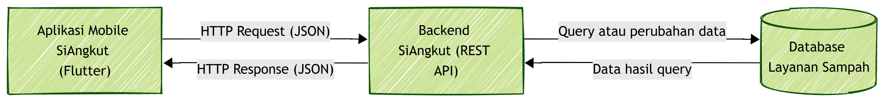
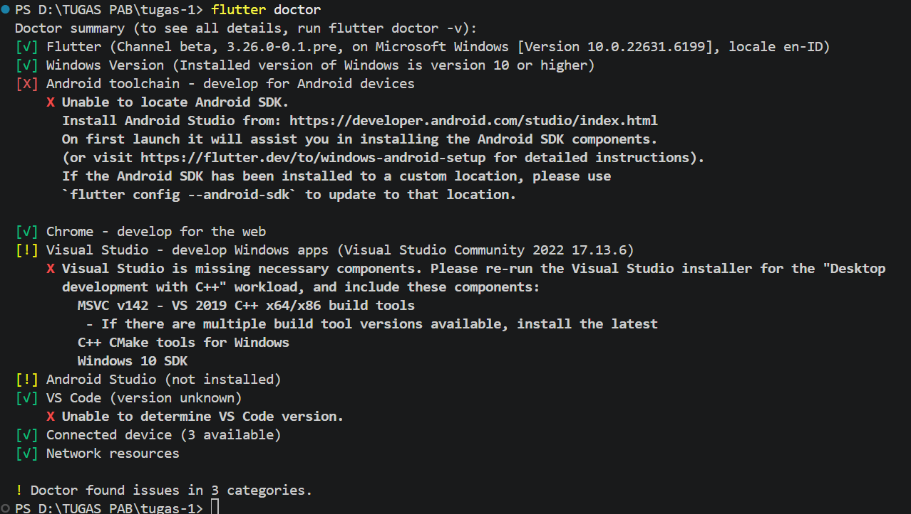
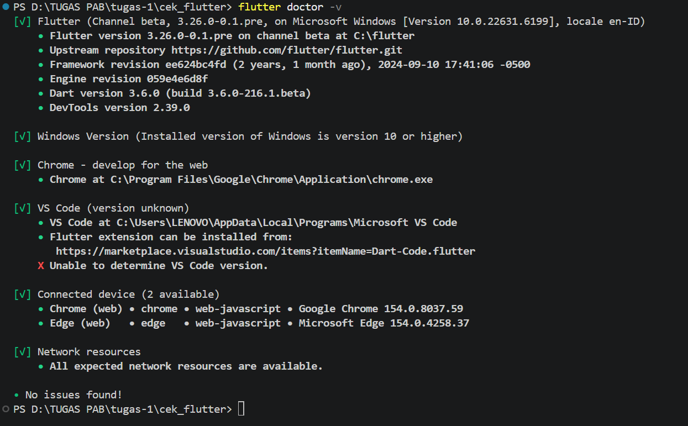
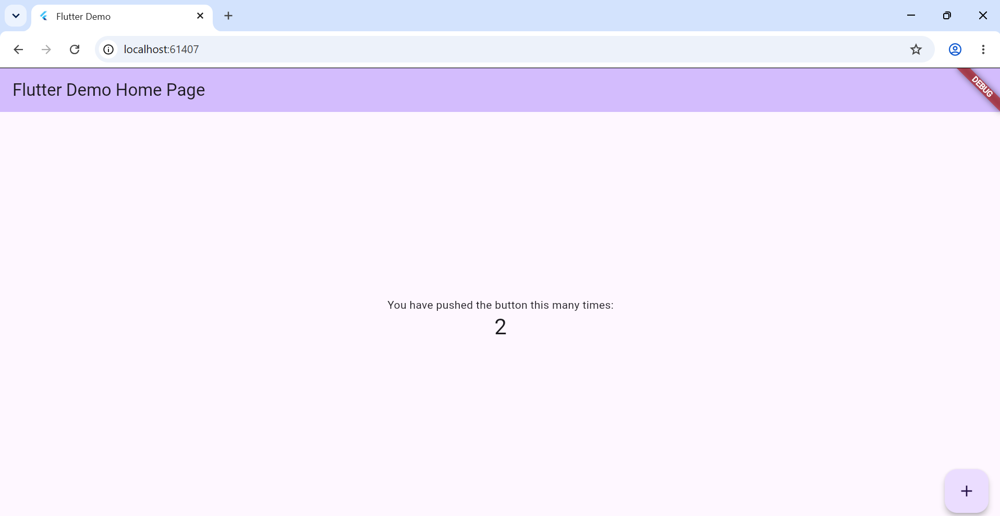

# Tugas 1 — Identifikasi Kebutuhan Aplikasi Bergerak

## SiAngkut

### Sistem Informasi Layanan Angkutan Sampah

| Identitas     | Keterangan                    |
| :------------ | :---------------------------- |
| **Nama**      | Clara Desmiati         |
| **NIM**       | 230660221005                   |
| **Kelas**     | SI-VIIA                       |
| **Domain SI** | Pelayanan Pengangkutan Sampah |

---

## 1. Deskripsi Sistem

SiAngkut merupakan rancangan aplikasi mobile yang ditujukan untuk mendukung layanan pengangkutan sampah rumah tangga di sekitar TPS Tanggulun, Desa Cimalaka. Berdasarkan informasi awal yang diperoleh, pengangkutan sampah dilakukan sekitar satu kali dalam seminggu dengan iuran sebesar Rp15.000 per bulan. Kebutuhan yang ingin dijawab melalui sistem ini adalah tersedianya media informasi terpusat bagi warga untuk mengetahui jadwal pengangkutan, memperoleh informasi iuran, memantau status layanan, dan menyampaikan laporan apabila terjadi kendala pengangkutan. Pengguna utama aplikasi adalah warga, sedangkan petugas bertanggung jawab mengelola data layanan melalui backend sistem. Aplikasi mobile dipilih karena karakteristik sesi penggunaan singkat memungkinkan warga memeriksa informasi dengan cepat, interaksi sentuh memudahkan pengisian laporan, dan konektivitas internet memungkinkan aplikasi bertukar data dengan backend.

---

## 2. Diagram Arsitektur

Diagram berikut menggambarkan komunikasi antara aplikasi mobile SiAngkut, backend layanan, dan database.

**File sumber:** `diagram.mmd`

### Alur Komunikasi

1. Warga membuka aplikasi SiAngkut dan memilih informasi atau layanan yang dibutuhkan.
2. Aplikasi mengirimkan HTTP Request dalam format JSON ke backend SiAngkut.
3. Backend memproses permintaan dan mengambil atau menyimpan data pada database.
4. Database mengembalikan hasil query kepada backend.
5. Backend mengirimkan HTTP Response dalam format JSON kembali ke aplikasi.
6. Petugas mengelola data pelanggan, jadwal, iuran, dan laporan melalui sisi backend.

---

## 3. Tabel Kebutuhan

| No. | Permintaan                                                        | Pengguna | Karakteristik Mobile yang Terkait                                                                               | Fitur Aplikasi                                | Materi Pemenuh                                           |
| :-: | :---------------------------------------------------------------- | :------- | :-------------------------------------------------------------------------------------------------------------- | :-------------------------------------------- | :------------------------------------------------------- |
|  1  | Mengetahui jadwal pengangkutan sampah                             | Warga    | Sesi penggunaan singkat, karena jadwal perlu diperiksa dengan cepat.                                            | Halaman jadwal pengangkutan                   | Minggu 3–5: widget dan UI; Minggu 4–6: navigasi          |
|  2  | Melihat informasi iuran pengangkutan sebesar Rp15.000 per bulan   | Warga    | Layar kecil, sehingga informasi iuran perlu disajikan secara ringkas dan mudah dibaca.                          | Halaman informasi iuran                       | Minggu 3–5: widget dan UI; Minggu 4–6: navigasi          |
|  3  | Memeriksa status pembayaran iuran                                 | Warga    | Konektivitas, karena status perlu diperoleh dari data layanan yang dikelola sistem.                             | Halaman status iuran                          | Minggu 9–10: integrasi REST API                          |
|  4  | Mengirim laporan apabila sampah belum diangkut sesuai jadwal      | Warga    | Interaksi sentuh dan konektivitas, karena warga perlu mengisi form dan mengirim laporan.                        | Form laporan layanan                          | Minggu 6: validasi form; Minggu 9–10: integrasi REST API |
|  5  | Melampirkan foto kondisi sampah pada laporan                      | Warga    | Kapabilitas perangkat, karena kamera digunakan untuk mengambil foto sebagai bukti pendukung.                    | Pengambilan dan lampiran foto                 | Minggu 11: fitur perangkat                               |
|  6  | Mengelola data pelanggan, jadwal pengangkutan, iuran, dan laporan | Petugas  | Tidak terkait langsung dengan karakteristik aplikasi mobile karena merupakan proses pengelolaan di sisi server. | Pengelolaan data melalui backend dan database | Di luar lingkup aplikasi mobile (backend SI)             |

### Batasan Lingkup

Kebutuhan nomor 1–5 berfokus pada fitur yang diakses warga melalui aplikasi mobile. Kebutuhan nomor 6 merupakan tanggung jawab sisi backend SI dan database untuk mendukung pengelolaan data layanan oleh petugas. Integrasi backend pada aplikasi merupakan rancangan kebutuhan yang dapat dikembangkan secara bertahap sesuai materi perkuliahan.

---

## 4. Bukti Environment Siap

Bukti berikut digunakan untuk menunjukkan bahwa lingkungan pengembangan Flutter telah diperiksa dan aplikasi Flutter berhasil dijalankan.

| Bukti                                       | File                         |
| :------------------------------------------ | :--------------------------- |
| Hasil `flutter doctor -v` sebelum perbaikan | `flutter-doctor/sebelum.png` |
| Hasil `flutter doctor -v` sesudah perbaikan | `flutter-doctor/sesudah.png` |
| Aplikasi Flutter Counter berjalan           | `aplikasi.png`               |

### Pemeriksaan Flutter Sebelum Perbaikan

### Pemeriksaan Flutter Sesudah Perbaikan

### Aplikasi Flutter Berjalan

---

## 5. Refleksi

Fitur perangkat yang paling relevan untuk SiAngkut adalah kamera smartphone. Kamera dapat digunakan warga untuk mengambil foto kondisi sampah ketika melaporkan kendala pengangkutan. Foto tersebut dapat menjadi informasi pendukung bagi petugas untuk memahami kondisi yang dilaporkan dan membantu proses tindak lanjut layanan.

---

**SiAngkut — Sistem Informasi Layanan Angkutan Sampah**
TPS Tanggulun, Desa Cimalaka

