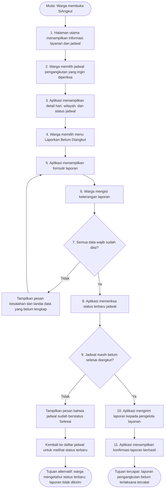

# Tugas 4 — Dokumen Kebutuhan dan User Flow SiAngkut

## 1. Deskripsi Aplikasi

SiAngkut adalah rancangan aplikasi layanan informasi angkutan sampah untuk membantu warga di wilayah Tanggulun, Desa Cimalaka memperoleh informasi biaya iuran bulanan, jadwal pengangkutan, dan status layanan tanpa harus selalu menanyakan langsung kepada petugas. Dalam konteks layanan yang memiliki iuran Rp15.000 per bulan dan kegiatan pengangkutan berkala, warga membutuhkan informasi yang dapat dilihat kembali saat diperlukan, sedangkan petugas membutuhkan cara untuk mengelola jadwal dan menindaklanjuti laporan pengangkutan. Bentuk aplikasi mobile dipilih karena warga dan petugas dapat mengakses informasi melalui ponsel dari rumah atau saat menjalankan kegiatan layanan, sehingga informasi lebih mudah dijangkau dibandingkan hanya mengandalkan pengumuman lisan atau catatan manual.

## 2. User Persona

### Persona 1 — Ibu Yeyen — Warga/Pelanggan Layanan

| Komponen | Isi |
|:--|:--|
| Nama dan peran | Ibu Yeyen — warga yang menggunakan layanan angkutan sampah. Nama ini merupakan persona fiktif, bukan individu nyata. |
| Tujuan | Mengetahui iuran, jadwal pengangkutan untuk wilayahnya, dan status pengangkutan; menyampaikan laporan jika sampah belum diangkut sesuai jadwal. |
| Kendala | Informasi jadwal atau perubahan status mungkin belum selalu tersedia di satu tempat, sehingga warga perlu bertanya langsung kepada petugas atau tetangga. |
| Perangkat dan konteks | Ponsel saat berada di rumah atau ketika membutuhkan informasi layanan sehari-hari. |
| Frekuensi penggunaan | Memeriksa jadwal sekitar setiap minggu dan membuka aplikasi kembali jika pengangkutan terlambat atau ada informasi yang ingin dipastikan. |

### Persona 2 — A Deni  — Petugas/Pengelola Layanan

| Komponen | Isi |
|:--|:--|
| Nama dan peran | A Deni — petugas/pengelola yang membantu mengatur jadwal dan memantau pelaksanaan layanan. Nama ini merupakan persona fiktif, bukan individu nyata. |
| Tujuan | Memastikan informasi jadwal yang dilihat warga sesuai, memantau laporan warga, dan memperbarui status pengangkutan setelah layanan dilakukan. |
| Kendala | Informasi laporan dan status jadwal dapat tersebar melalui percakapan atau catatan terpisah, sehingga perlu diperiksa agar tidak ada laporan yang terlewat. |
| Perangkat dan konteks | Ponsel saat memeriksa jadwal, menerima laporan, atau setelah kegiatan pengangkutan. |
| Frekuensi penggunaan | Pada hari layanan dan setiap kali ada perubahan jadwal atau laporan masuk. |

Persona ini merupakan rancangan awal untuk membantu keputusan fitur. Jika ada kesempatan, konfirmasikan kendala dan frekuensi penggunaan kepada warga atau petugas yang memahami proses sebenarnya.

## 3. Kebutuhan Fungsional

| ID | Rumusan Kebutuhan | Terkait Persona |
|:---|:--|:--|
| F-01 | Warga dapat melihat informasi iuran bulanan layanan angkutan sampah pada halaman informasi layanan. | Persona 1 — Warga |
| F-02 | Warga dapat melihat jadwal pengangkutan yang berlaku untuk wilayah layanannya. | Persona 1 — Warga |
| F-03 | Warga dapat melihat status pengangkutan pada setiap jadwal yang ditampilkan. | Persona 1 — Warga |
| F-04 | Warga dapat mengirim laporan tentang jadwal pengangkutan yang belum terlaksana dengan memilih jadwal dan mengisi keterangan laporan. | Persona 1 — Warga |
| F-05 | Petugas/pengelola dapat melihat daftar laporan pengangkutan yang dikirim warga. | Persona 2 — Petugas/Pengelola |
| F-06 | Petugas/pengelola dapat memperbarui status jadwal menjadi “Selesai” setelah pengangkutan dilakukan. | Persona 2 — Petugas/Pengelola |
| F-07 | Petugas/pengelola dapat memperbarui informasi jadwal pengangkutan yang ditampilkan kepada warga. | Persona 2 — Petugas/Pengelola |
| F-08 | Warga dapat melihat riwayat status pengangkutan dari periode sebelumnya. | Persona 1 — Warga |
| F-09 | Warga dapat menerima notifikasi ketika jadwal pengangkutan berubah. | Persona 1 — Warga |

Kebutuhan di atas ditulis sebagai rencana fungsi aplikasi, bukan pernyataan bahwa seluruh fitur sudah tersedia pada prototipe Flutter saat ini. Setiap rumusan dapat diperiksa melalui pengujian apakah aktor yang disebutkan dapat melakukan aksi dan memperoleh hasil yang dijelaskan.

## 4. Kebutuhan Nonfungsional

| ID | Kategori | Rumusan | Kriteria Terukur |
|:---|:--|:--|:--|
| NF-01 | Kegunaan | Informasi utama SiAngkut harus dapat ditemukan warga tanpa melalui banyak halaman. | Dalam uji coba, pengguna dapat menemukan informasi iuran dan jadwal dari halaman utama dalam maksimal 3 interaksi. |
| NF-02 | Kinerja | Daftar jadwal pengangkutan harus ditampilkan tanpa menunggu terlalu lama pada kondisi jaringan stabil. | Pada pengujian dengan jaringan stabil, daftar jadwal tampil dalam waktu maksimal 3 detik pada sedikitnya 9 dari 10 percobaan. |
| NF-03 | Kompatibilitas/tampilan | Informasi layanan harus tetap terbaca pada layar ponsel yang umum digunakan. | Pada lebar layar 360 piksel dan 390 piksel, teks dan kontrol utama tidak terpotong serta halaman tidak memerlukan gulir horizontal. |

Kriteria tersebut merupakan target pengujian yang direncanakan, bukan hasil pengukuran yang sudah dilakukan.

## 5. Prioritas Fitur (MoSCoW)

| Prioritas | ID Kebutuhan | Alasan |
|:--|:--|:--|
| Must have | F-01, F-02, F-03, F-04 | Informasi iuran, jadwal, status, dan laporan merupakan kebutuhan inti warga untuk memahami layanan dan menyampaikan masalah pengangkutan. Empat fitur ini mendukung tujuan utama Persona 1. Jumlahnya dibatasi empat fitur, sesuai batas maksimal lima fitur pada kategori Must have. |
| Should have | F-05, F-06, F-07 | Pengelolaan laporan, pembaruan status, dan perubahan jadwal dibutuhkan agar informasi untuk warga tetap terjaga, tetapi pengembangan awal dapat dimulai dari penyajian informasi dan pencatatan laporan. Fitur ini mendukung pekerjaan Persona 2. |
| Could have | F-08 | Riwayat status membantu warga melihat catatan periode sebelumnya, tetapi layanan awal masih dapat digunakan dengan melihat jadwal dan status terkini. Karena itu, riwayat dapat ditambahkan setelah fungsi utama berjalan. |
| Won't have (saat ini) | F-09 | Notifikasi otomatis ditunda pada versi awal karena membutuhkan mekanisme pengiriman dan pengaturan notifikasi yang belum menjadi cakupan utama analisis awal. Penundaan ini bukan berarti fitur dihapus; fitur dapat dipertimbangkan kembali setelah fungsi jadwal dan status stabil. |

## 6. Pemetaan Kebutuhan ke Antarmuka

Pemetaan ini adalah rencana antarmuka berdasarkan widget yang dipelajari pada Pertemuan 3. Sebagian halaman masih berupa rancangan kebutuhan untuk pengembangan berikutnya, bukan fitur yang seluruhnya sudah diimplementasikan pada prototipe saat ini.

| ID Kebutuhan | Rumusan (ringkas) | Prioritas | Halaman yang Memenuhi | Widget yang Direncanakan (P3) |
|:--|:--|:--|:--|:--|
| F-01 | Melihat iuran bulanan | Must have | Halaman utama / ringkasan layanan | `Scaffold`, `AppBar`, `Column`, `Card`, `Row`, `Text` |
| F-02 | Melihat jadwal per wilayah | Must have | Halaman utama / jadwal layanan | `Scaffold`, `ListView.builder`, `Card`, `ListTile` |
| F-03 | Melihat status tiap jadwal | Must have | Daftar jadwal dan detail jadwal | `ListView.builder`, `ListTile`, `Row`, `Text` |
| F-04 | Mengirim laporan belum diangkut | Must have | Form laporan pengangkutan | `Scaffold`, `AppBar`, `Column`, `TextField`, `ElevatedButton` |
| F-05 | Melihat laporan warga | Should have | Halaman daftar laporan petugas | `Scaffold`, `ListView.builder`, `Card`, `ListTile` |
| F-06 | Memperbarui status pengangkutan | Should have | Halaman detail jadwal petugas | `Scaffold`, `Column`, `Row`, `DropdownButton`, `ElevatedButton` |
| F-07 | Memperbarui jadwal | Should have | Halaman pengelolaan jadwal | `Scaffold`, `Column`, `TextField`, `ElevatedButton`, `ListView.builder` |
| F-08 | Melihat riwayat status | Could have | Halaman riwayat pengangkutan | `Scaffold`, `ListView.builder`, `Card`, `ListTile` |
| F-09 | Menerima notifikasi perubahan jadwal | Won't have (saat ini) | Halaman notifikasi (rencana lanjutan) | `Scaffold`, `AppBar`, `ListView.builder`, `ListTile`, `Icon` |

## 7. User Flow

### 7.1 Identitas Alur

| Aspek | Isi |
|:--|:--|
| Nama alur | Melaporkan jadwal pengangkutan sampah yang belum terlaksana |
| Aktor | Warga/pelanggan SiAngkut (Persona 1) |
| Tujuan alur | Laporan tentang pengangkutan yang belum dilakukan berhasil tercatat dan warga menerima konfirmasi; jika status sudah selesai, warga mendapat informasi status terbaru. |

### 7.2 Diagram User Flow

Diagram berikut menggambarkan satu tujuan pengguna dan memiliki dua titik keputusan. Setiap keputusan mempunyai cabang “Tidak” yang ditindaklanjuti dengan pesan dan langkah lanjutan.

### 7.3 Daftar Langkah

| No. | Jenis | Langkah/Halaman | Bila gagal |
|:--:|:--|:--|:--|
| 1 | Mulai | Warga membuka aplikasi SiAngkut. | — |
| 2 | Halaman | Halaman utama menampilkan informasi layanan dan jadwal. | — |
| 3 | Aksi | Warga memilih jadwal pengangkutan yang ingin diperiksa. | — |
| 4 | Halaman | Aplikasi menampilkan detail hari, wilayah, dan status jadwal. | — |
| 5 | Aksi | Warga memilih “Laporkan Belum Diangkut”. | — |
| 6 | Halaman | Aplikasi menampilkan formulir laporan. | — |
| 7 | Input | Warga mengisi keterangan laporan. | — |
| 8 | Keputusan 1 | Apakah semua data wajib sudah diisi? | Jika tidak, tampilkan pesan kesalahan dan kembali ke formulir. |
| 9 | Validasi | Aplikasi memeriksa status terbaru jadwal. | — |
| 10 | Keputusan 2 | Apakah jadwal masih belum selesai diangkut? | Jika tidak, tampilkan informasi jadwal sudah selesai dan arahkan warga kembali ke daftar jadwal. |
| 11 | Proses | Aplikasi mengirim laporan kepada pengelola layanan. | — |
| 12 | Konfirmasi | Aplikasi menampilkan konfirmasi laporan berhasil. | — |
| 13 | Tujuan | Laporan belum terlaksana tercatat; warga mengetahui laporan berhasil dikirim. | — |

### 7.4 Daftar Pemeriksaan Diagram

- [x] Jumlah langkah proses minimal 8, di luar titik mulai dan tujuan.
- [x] Jumlah titik keputusan minimal 2.
- [x] Setiap keputusan memiliki cabang “Ya” dan “Tidak”, dan keduanya ditindaklanjuti.
- [x] Tidak ada langkah yang buntu; alur mengarah ke proses berikutnya, kembali ke formulir, atau ke salah satu tujuan akhir.
- [x] Label langkah menggunakan kalimat yang dapat dipahami.
- [ ] Diagram ditelusuri bersama satu teman sekelas (peer review). Centang setelah benar-benar dilakukan.