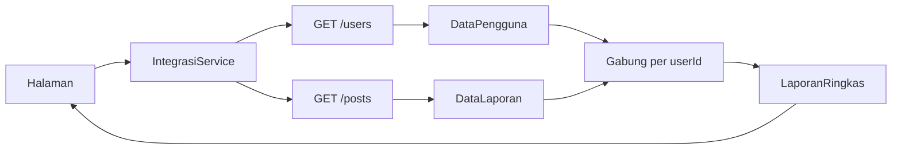

# Tugas 10: Integrasi Data dan Proses Bisnis

| | |
|:--|:--|
| **Nama** | Galih Permana Sidik |
| **NIM** | 230660221002 |
| **Kelas** | SI-VIIA |
| **Project** | SiLapor Kampus (pelaporan kerusakan fasilitas kampus) |

## Deskripsi Singkat

Halaman daftar laporan menampilkan setiap laporan bersama nama pelapornya. Nama itu berasal dari endpoint yang berbeda dengan laporan, sehingga service mengambil keduanya, mencocokkannya lewat `userId`, dan menyerahkan satu daftar ringkas ke halaman. Status laporan (Menunggu, Diproses, Selesai) ditampilkan sebagai chip dan dapat difilter. Backend SiLapor belum tersedia, sehingga endpoint simulasi JSONPlaceholder dipakai.

## Struktur Folder

```text
230660221002-galih-permana-sidik/
├── lib/
│   ├── main.dart                     halaman daftar dan 4 kondisi tampilan
│   ├── models/
│   │   ├── data_pengguna.dart        model pelapor (GET /users)
│   │   ├── data_laporan.dart         model laporan dan enum StatusLaporan (GET /posts)
│   │   └── laporan_ringkas.dart      model hasil gabungan untuk halaman
│   └── services/
│       └── integrasi_service.dart    request, parsing, penggabungan, aturan status
├── pubspec.yaml
├── README.md
├── diagram-integrasi.md
├── jawaban-quiz-pertemuan-10.md
└── refleksi.md
```

## 1. Endpoint dan Metode HTTP

| Metode | URL | Fungsi di SiLapor |
|:-------|:----|:------------------|
| GET | `https://jsonplaceholder.typicode.com/users` | Data pelapor |
| GET | `https://jsonplaceholder.typicode.com/posts?_limit=20` | Data laporan |

Kedua request dijalankan bersamaan dengan `Future.wait`. Alasannya: URL `/posts` tidak membutuhkan hasil `/users`, sehingga tidak ada alasan menunggu satu selesai dulu. Waktu tunggu mengikuti request yang paling lambat, bukan jumlah keduanya. Bila salah satu request bergantung pada hasil yang lain (misalnya `/users/{id}` setelah id diketahui dari laporan), request harus berurutan dengan `await`.

## 2. Pemetaan Field JSON ke Model Dart

**`DataPengguna`** (dari `/users`)

| Key JSON | Field Dart | Tipe | Nilai bila tidak ada |
|:---------|:-----------|:-----|:---------------------|
| `id` | `id` | `int` | `0` |
| `name` | `nama` | `String` | `'Tanpa nama'` |

**`DataLaporan`** (dari `/posts`)

| Key JSON | Field Dart | Tipe | Nilai bila tidak ada |
|:---------|:-----------|:-----|:---------------------|
| `id` | `id` | `int` | `0` |
| `userId` | `userId` | `int` | `0` |
| `title` | `judul` | `String` | `'Tanpa judul'` |
| `body` | `deskripsi` | `String` | `'-'` |
| `status` | `status` | `StatusLaporan` | `menunggu` (lewat `statusDariJson`) |
| (ada tidaknya `status`) | `statusDariServer` | `bool` | `false` |

**`LaporanRingkas`** (model tampilan, bukan response API)

| Field | Sumber |
|:------|:-------|
| `id`, `judul`, `deskripsi` | `DataLaporan` |
| `namaPelapor` | `DataPengguna.nama`, dicocokkan lewat `userId`. Bila tidak ada pasangannya: `'Pelapor tidak dikenal'` |
| `status` | `DataLaporan.status` bila server mengirim, selain itu aturan simulasi di bawah |

## 3. Identifier Penggabungan

`DataLaporan.userId` dicocokkan dengan `DataPengguna.id`. Service membuat peta `id -> nama` dari daftar pengguna, lalu mencari nama pelapor untuk tiap laporan. Pencarian pada peta jauh lebih murah dibanding mencari ulang di daftar untuk setiap laporan, dan laporan yang `userId`-nya tidak punya pasangan tetap tampil, tidak hilang.

## 4. Aturan Proses Bisnis

- `statusDariJson` memetakan teks status server ke enum `StatusLaporan`. Nilai tidak dikenal atau kosong menjadi `menunggu`, status awal laporan baru (F-01). Aturan ini hanya ada di satu fungsi.
- `/posts` tidak punya field status, sehingga service memakai aturan simulasi: `id` kelipatan 5 menjadi Selesai, kelipatan 2 menjadi Diproses, sisanya Menunggu. Ini murni pengganti agar ketiga status bisa dilihat pada halaman. Dengan backend sungguhan, aturan simulasi dihapus.
- Bila salah satu request gagal, seluruh pemuatan dianggap gagal. Daftar yang tampil tanpa nama pelapor tidak cukup bagi petugas untuk menindaklanjuti laporan.

## 5. Diagram Alur

Diagram alur, urutan request, dan kondisi halaman ada pada [`diagram-integrasi.md`](diagram-integrasi.md).



## 6. Kondisi Halaman dan Penanganan Error

| Kondisi | Tampilan |
|:--------|:---------|
| Loading | Indikator berputar dan teks "Memuat laporan dan data pelapor..." |
| Data | Chip filter status dan daftar kartu laporan, bisa tarik untuk muat ulang |
| Kosong (server) | Ikon kotak masuk, "Belum ada laporan", tombol Muat Ulang. Bukan pesan error |
| Kosong (filter) | Teks "Tidak ada laporan berstatus ..." tanpa tombol, karena data ada dan hanya filter yang menyaring |
| Error | Ikon awan, pesan dari `ApiException`, dan tombol **Coba Lagi** yang memanggil ulang kedua request |

Semua request lewat helper `_jalankan` yang memasang `timeout` 10 detik dan `try-catch`, lalu mengubah kegagalan menjadi `ApiException` berpesan bahasa Indonesia (timeout, koneksi putus, status 400/404/5xx, status lain, JSON rusak, bentuk data salah). Stack trace tidak pernah ditampilkan ke pengguna.

## 7. Cara Menjalankan

1. Pastikan Flutter SDK terpasang dan target web aktif.
2. Dari folder ini:

```bash
flutter pub get
flutter analyze
flutter run -d chrome
```

Bila folder ini belum berupa project Flutter lengkap (belum ada `web/`), jalankan `flutter create .` sekali pada folder ini. Perintah itu menambahkan folder platform tanpa menimpa `lib/` dan `pubspec.yaml` yang sudah ada, tetapi periksa kembali bahwa `http` masih tercatat pada `pubspec.yaml`.

Memicu kondisi untuk tangkapan layar (semua pada `IntegrasiService`, kembalikan ke nilai awal setelahnya):

| Kondisi | Cara |
|:--------|:-----|
| Loading | `jedaSimulasiDetik = 3` |
| Data | Nilai awal |
| Kosong | `filterUserId = 999` (server membalas list kosong) |
| Error | `_jalurLaporan = '/postsx'` (server membalas 404) |

## 8. Batasan API Simulasi

- JSONPlaceholder tidak memiliki data ruang atau lokasi, kategori kerusakan, tanggal, dan status laporan. Field itu dari model Tugas 7 belum dapat dihubungkan sampai backend SiLapor tersedia.
- Status laporan pada layar adalah hasil aturan simulasi, bukan status sebenarnya.
- Data tetap dan bersifat contoh. Judul dan isinya berbahasa Latin, dan `/users` hanya berisi 10 pengguna.
- Server tidak menyimpan perubahan, sehingga halaman ini hanya membaca data. Pembuatan laporan lewat POST ada pada Tugas 9.
- Endpoint publik bisa lambat atau tidak dapat dijangkau. Penanganan error di atas dibuat untuk kondisi itu.
- Tidak ada token atau data pribadi pada source code. Autentikasi dibahas pada Pertemuan 12.

## Refleksi dan Deklarasi AI

Refleksi dan deklarasi penggunaan AI ada pada [`refleksi.md`](refleksi.md).
