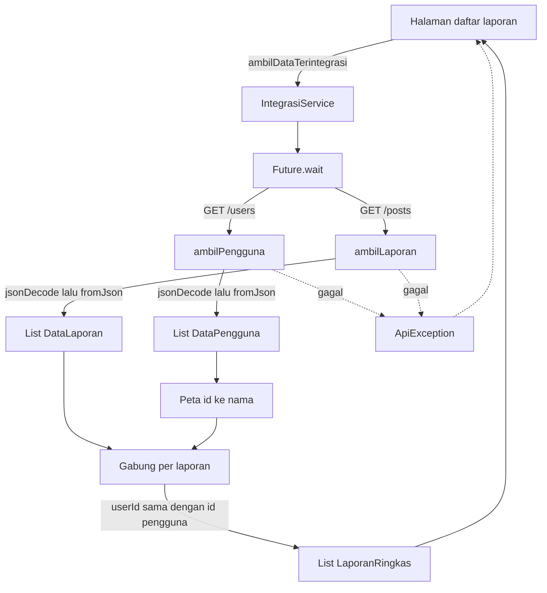
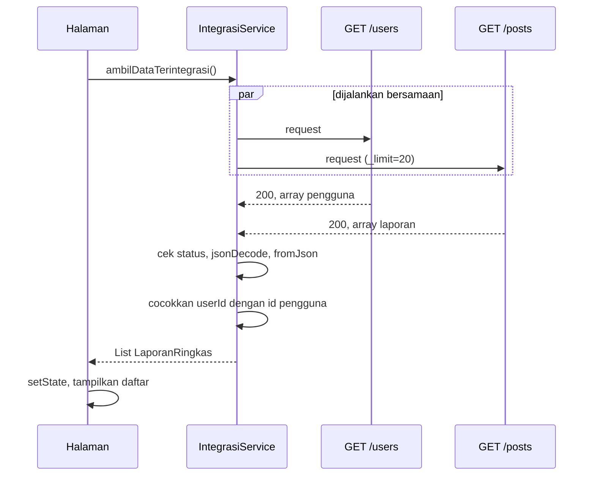
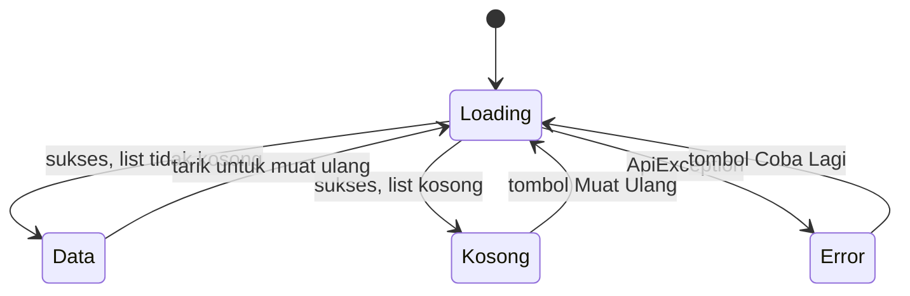

# Diagram Integrasi Data: Tugas 10

Alur ini berlaku untuk satu kali pemuatan halaman daftar laporan SiLapor Kampus.

## 1. Alur Request, Parsing, dan Penyajian

Garis putus adalah jalur gagal. Service mengubah semua kegagalan menjadi `ApiException`, dan halaman cukup menangkap satu tipe itu.

## 2. Urutan Request dan Response

## 3. Kondisi Halaman

Kondisi Kosong dipisahkan dari Error karena request-nya berhasil. Pesan error pada daftar yang memang kosong akan menyesatkan petugas dan mendorong percobaan ulang yang tidak ada gunanya.
