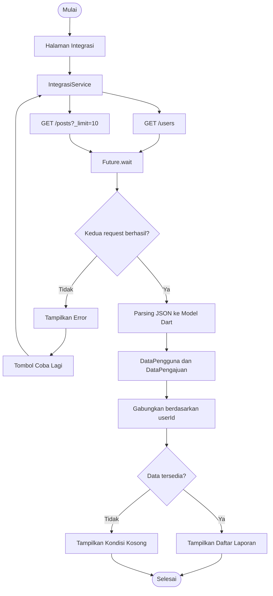
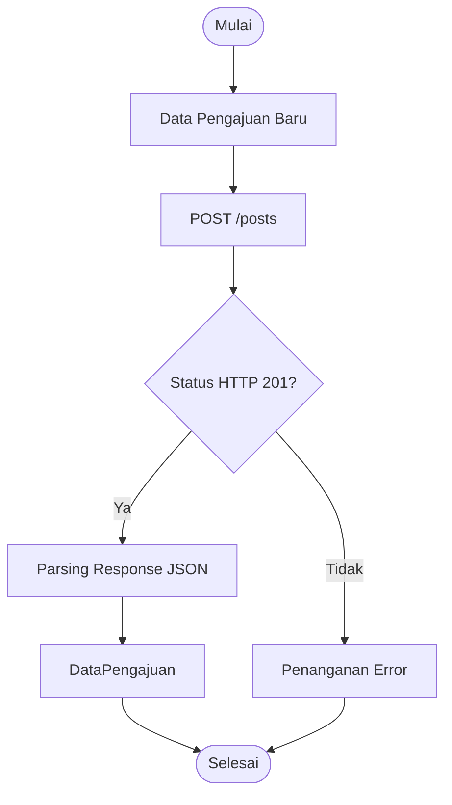

# Diagram Integrasi Data SIAngkut

## Alur Request dan Response

## Alur POST

## Penjelasan

1. Halaman meminta data melalui IntegrasiService.
2. Service menjalankan dua request GET menggunakan Future.wait.
3. Respons JSON diubah menjadi model DataPengguna dan DataPengajuan.
4. Data digabungkan menggunakan userId sebagai identifier.
5. Hasil gabungan dikirim ke halaman untuk ditampilkan.
6. Jika terjadi kegagalan, halaman menyediakan tombol Coba Lagi.
7. POST digunakan untuk simulasi pengiriman pengajuan baru.
