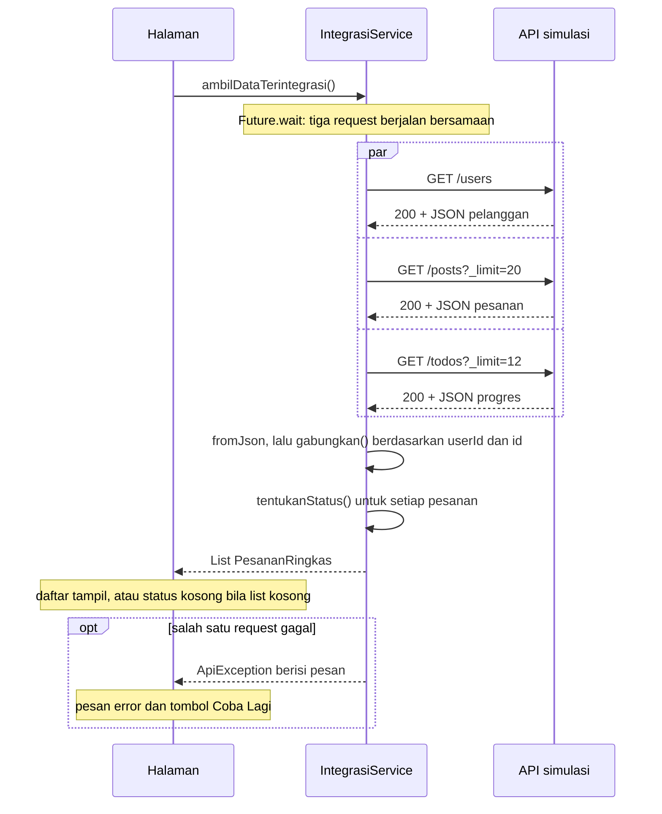
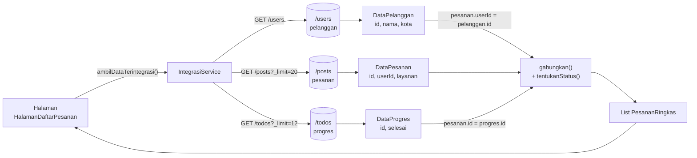
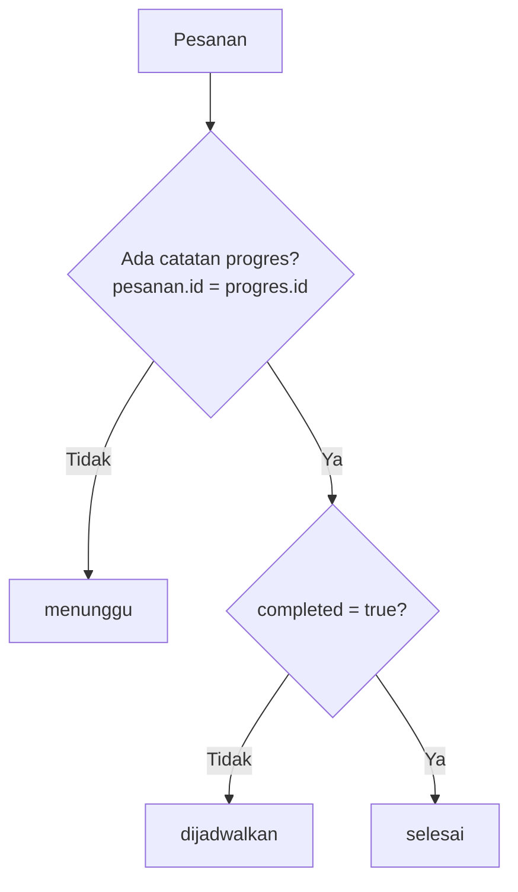

# Diagram Integrasi Data — Glazent.pro

| | |
|:--|:--|
| **Nama** | Fajar |
| **NIM** | 230660221093 |
| **Kelas** | SI-VIIA |

---

## 1. Alur Request dan Response

Tiga request tidak saling bergantung sehingga dijalankan bersamaan dengan `Future.wait`. Bila salah satu gagal, halaman menerima satu `ApiException` yang menyebutkan data yang gagal.

## 2. Penggabungan Data Berdasarkan Identifier

## 3. Aturan Proses Bisnis: Status Pesanan

Aturan ini hanya berada pada `IntegrasiService.tentukanStatus`.

