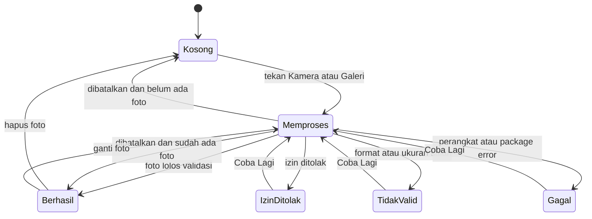

# Dokumen Fitur Perangkat: Lampiran Foto Kerusakan
| | |
|:--|:--|
| **Nama** | Galih Permana Sidik |
| **NIM** | 230660221002 |
| **Kelas** | SI-VIIA |

## 1. Fitur yang Dipilih

Kamera dan galeri melalui package `image_picker`, untuk melampirkan foto kerusakan fasilitas pada form Buat Laporan.

## 2. Analisis Kebutuhan

| Aspek | Penjelasan |
|:------|:-----------|
| Aktor | Mahasiswa pelapor yang mengisi form laporan (F-01). Petugas membaca foto itu saat menilai kerusakan |
| Tujuan pada proses bisnis | Laporan teks seperti "AC bocor" sering kurang jelas. Foto memperlihatkan tingkat kerusakan sehingga petugas dapat memperkirakan penanganan sebelum turun ke lokasi |
| Data keluaran | Satu foto: nama berkas, ukuran, dan isi gambar dalam bentuk bytes. Disimpan di state form, bukan di berkas lokal |
| Permission | Kamera dan akses galeri. Lihat bagian 4 |
| Target platform | Web (Chrome) untuk alur galeri dan validasi. Android atau iOS untuk kamera sungguhan |
| Sifat fitur | Opsional. Laporan tetap dapat dikirim tanpa foto |
| Konsekuensi izin ditolak | Pelapor melihat pesan alasan beserta langkah membuka Pengaturan. Form tetap dapat dipakai dan laporan dikirim tanpa foto |
| Konsekuensi pembatalan | Tidak ada perubahan. Foto yang sudah terpilih tetap tampil dan pengguna hanya mendapat pemberitahuan singkat |

Keterkaitan dengan tugas sebelumnya: model `Laporan` pada Tugas 7 memiliki field `fotoTerlampir` yang pada waktu itu hanya simulasi (tombol yang menandai "terlampir"). Tugas ini menggantinya dengan foto sungguhan. Pengiriman foto ke server belum dilakukan karena memerlukan dukungan unggah berkas pada backend SiLapor.

## 3. Fitur yang Dipertimbangkan dan Tidak Dipilih

| Fitur | Alasan tidak dipilih |
|:------|:---------------------|
| Lokasi | Lokasi laporan berupa gedung dan ruang yang pelapor ketik sendiri. Koordinat GPS tidak akurat di dalam gedung dan menambah risiko privasi tanpa menambah nilai |
| File | Tidak ada dokumen pendukung pada alur laporan |
| Notification | Bernilai untuk memberi kabar perubahan status (F-07), tetapi membutuhkan backend yang mengirim event. Belum tersedia |

## 4. Permission dan Konfigurasi Platform

Mengacu pada dokumentasi `image_picker` versi yang dipakai. Periksa kembali dokumentasinya bila versi package diperbarui.

| Platform | Konfigurasi |
|:---------|:------------|
| Web | Tidak ada konfigurasi. Galeri membuka dialog pilih berkas browser. Kamera pada web desktop umumnya juga membuka pemilih berkas, bukan kamera langsung, sehingga kamera sungguhan perlu diuji pada perangkat |
| Android | Tidak ada konfigurasi tambahan agar `image_picker` berjalan. Bila aplikasi atau package lain mendeklarasikan `CAMERA` pada `AndroidManifest.xml`, izin kamera diminta saat runtime |
| iOS | Tambahkan pada `ios/Runner/Info.plist`: `NSCameraUsageDescription` dan `NSPhotoLibraryUsageDescription` beserta teks alasan, misalnya "Foto dipakai sebagai lampiran laporan kerusakan." |

## 5. Diagram Kondisi

## 6. Aturan Validasi

- Format: JPG, JPEG, atau PNG.
- Ukuran: maksimal 5 MB. Batas ini membatasi beban unggah di jaringan kampus dan ukuran data yang ditahan di memori.
- Kamera menurunkan lebar ke 1600 px dan kualitas 80 agar ukuran wajar. Pengaturan ini mungkin diabaikan pada web.

## 7. Pemisahan Tanggung Jawab

| Lapisan | Tugas |
|:--------|:------|
| `FotoService` | Memanggil `image_picker`, memetakan hasilnya (berhasil, `null` untuk batal, `FotoException` untuk izin, tidak valid, dan gagal), validasi format dan ukuran |
| Widget (`main.dart`) | Menyimpan state, memilih tampilan sesuai kondisi, tidak mengimpor package perangkat |
