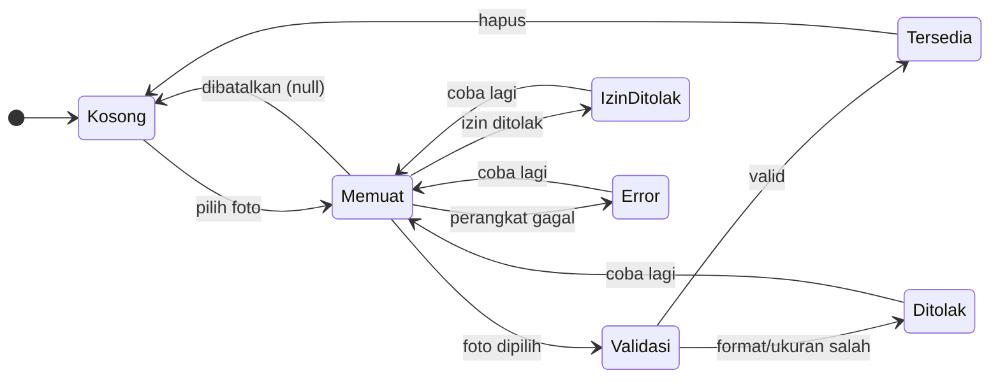
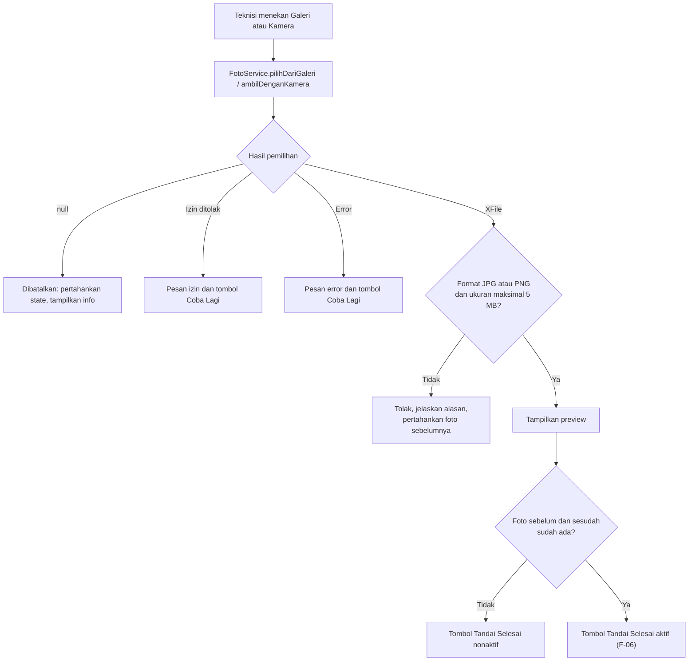

# Dokumen Fitur Perangkat — Glazent.pro

| | |
|:--|:--|
| **Nama** | Fajar |
| **NIM** | 230660221093 |
| **Kelas** | SI-VIIA |
| **Domain** | Usaha mikro jasa — Glazent.pro (glass cleaning & nanocoating) |
| **Fitur terpilih** | Kamera dan galeri (`image_picker`) |

---

## 1. Analisis Pemilihan Fitur

Fitur dipilih berdasarkan kebutuhan pada dokumen Tugas 4, bukan karena package tersedia.

| Fitur | Tujuan pengguna di Glazent.pro | Data keluaran | Keputusan | Alasan |
|:------|:-------------------------------|:--------------|:----------|:-------|
| **Kamera dan galeri** | Teknisi memotret kondisi kaca sebelum dan sesudah pengerjaan (F-05) | `XFile` (nama, ukuran, isi gambar) | **Dipilih** | F-05 berprioritas Must have dan belum terpenuhi. Foto menjadi bukti hasil kerja dan dasar klaim garansi nanocoating |
| Lokasi | Mengetahui posisi teknisi atau pelanggan | Latitude dan longitude | Tidak dipilih | Alamat pekerjaan sudah diisi pada form pemesanan (F-01). Koordinat tidak dibutuhkan proses saat ini dan menambah izin serta risiko privasi |
| File | Melampirkan dokumen pendukung | Path atau bytes file | Tidak dipilih | Tidak ada kebutuhan dokumen pada Tugas 4; bukti pekerjaan berupa foto |
| Notification | Mengingatkan jadwal kunjungan | Event atau pesan | Tidak dipilih | F-08 berstatus Won't have pada MoSCoW Tugas 4 |

## 2. Fitur Terpilih: Kamera dan Galeri

| Aspek | Isi |
|:------|:----|
| Aktor | Teknisi lapangan (persona Dimas, Tugas 4) |
| Tujuan pada proses bisnis | Melampirkan foto kondisi kaca sebelum dan sesudah pengerjaan (F-05). Kedua foto menjadi syarat untuk menandai pekerjaan selesai (F-06) |
| Data keluaran | `XFile` yang dibaca menjadi gambar untuk preview. Pada tugas ini foto hanya disimpan pada state aplikasi |
| Permission | Lihat bagian 3 |
| Target platform | Verifikasi pada web (Chrome). Android dan iOS mengikuti dokumentasi package, namun belum diuji |
| Bila pengguna membatalkan | `XFile?` bernilai `null`. Bukan error: halaman menampilkan informasi singkat dan mempertahankan foto sebelumnya |
| Bila permission ditolak | Pesan yang menjelaskan penyebab dan langkah mengaktifkan izin di Pengaturan, serta tombol "Coba Lagi". Foto sebelumnya dipertahankan |
| Bila package atau perangkat error | Pesan kegagalan yang informatif tanpa detail teknis, serta tombol "Coba Lagi" |

## 3. Permission dan Konfigurasi Platform

| Platform | Konfigurasi | Catatan |
|:---------|:------------|:--------|
| Web | Tidak ada konfigurasi izin untuk memilih file | Pada Chrome desktop, tombol Kamera umumnya membuka pemilih file, bukan kamera langsung. Perilaku kamera bergantung pada browser dan perangkat |
| Android | Mengikuti dokumentasi `image_picker`. Package memakai pemilih foto dan aplikasi kamera bawaan sistem, sehingga umumnya tidak memerlukan deklarasi izin tambahan | Bila aplikasi atau plugin lain mendeklarasikan izin `CAMERA` pada manifest, izin tersebut harus diberikan pengguna agar kamera dapat dipakai |
| iOS | Tambahkan keterangan penggunaan pada `ios/Runner/Info.plist` | Tanpa keterangan ini aplikasi dapat berhenti saat kamera atau galeri dibuka |

Konfigurasi iOS (`Info.plist`):

```xml
<key>NSCameraUsageDescription</key>
<string>Kamera dipakai untuk memotret kondisi kaca sebagai bukti pekerjaan.</string>
<key>NSPhotoLibraryUsageDescription</key>
<string>Galeri dipakai untuk memilih foto kondisi kaca sebagai bukti pekerjaan.</string>
```

Konfigurasi Android dan iOS perlu dicocokkan kembali dengan dokumentasi `image_picker` versi yang dipakai, karena aturan platform dapat berubah.

## 4. Aturan Validasi Foto

| Aturan | Nilai | Pesan bila dilanggar |
|:-------|:------|:---------------------|
| Format | JPG, JPEG, atau PNG | Format foto tidak didukung. Gunakan JPG atau PNG. |
| Ukuran maksimal | 5 MB | Ukuran foto X MB melebihi batas 5 MB. |
| File kosong | Ditolak | File foto kosong atau tidak dapat dibaca. |

Format ditentukan dari ekstensi nama file; bila tidak ada ekstensi, jenis MIME dipakai sebagai cadangan. Saat memilih foto, `image_picker` juga diminta memperkecil lebar maksimal 1600 piksel dan kualitas 80 agar ukuran file lebih kecil.

## 5. Siklus Fitur dan Alur Proses

Siklus kondisi satu slot foto:




Alur dari pemilihan foto sampai proses bisnis:



## 6. Penanganan Setiap Kondisi

| Kondisi | Penyebab | Tampilan dan perlakuan |
|:--------|:---------|:-----------------------|
| Loading | Pemilihan atau pembacaan foto berjalan | `LinearProgressIndicator`; tombol Galeri, Kamera, dan Hapus nonaktif |
| Berhasil | `XFile` valid | Preview, nama file, ikon centang; slot dihitung "ada foto" |
| Dibatalkan | `XFile?` bernilai `null` | SnackBar informasi; foto sebelumnya dipertahankan; tidak ditampilkan sebagai error |
| Izin ditolak | `IzinDitolakException` | Pesan izin dan tombol Coba Lagi; foto sebelumnya dipertahankan |
| Error | `FotoException` atau kesalahan tak terduga | Pesan kegagalan dan tombol Coba Lagi |
| Validasi gagal | Format atau ukuran tidak sesuai | Pesan alasan dan tombol Coba Lagi; foto sebelumnya dipertahankan |

Pembagian tanggung jawab: `FotoService` memanggil `image_picker`, memetakan error menjadi `IzinDitolakException` atau `FotoException`, dan memvalidasi foto. Widget hanya memanggil service, menyimpan hasil pada state, dan menampilkan kondisi.

## 7. Integrasi ke Proses Bisnis

Hasil fitur dipakai pada alur aplikasi, bukan hanya ditampilkan:

- Tombol **Tandai Selesai** (F-06) hanya aktif bila foto sebelum **dan** foto sesudah sudah dilampirkan (F-05).
- Bila salah satu foto dihapus, tombol kembali nonaktif.
- Setelah ditandai selesai, status berubah menjadi `selesai` dan kedua slot dikunci.

## 8. Keterbatasan

- Foto belum dikirim ke server dan hanya tersimpan pada state, sehingga hilang saat aplikasi ditutup. Pengiriman memerlukan backend yang menerima unggahan.
- Setiap slot hanya menampung satu foto.
- Data tugas pada halaman (layanan, pelanggan, teknisi) berupa contoh statis, belum terhubung ke API Tugas 10.
- Skenario izin ditolak dan error package pada web diuji dengan mode simulasi (`FotoService.simulasi`), karena tidak dapat dipicu sungguhan pada web.
- Android dan iOS belum diuji.
