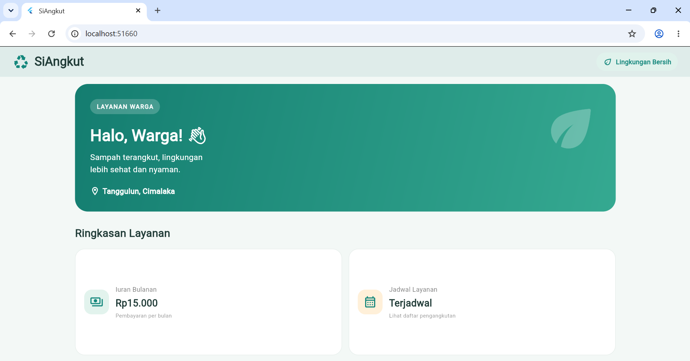
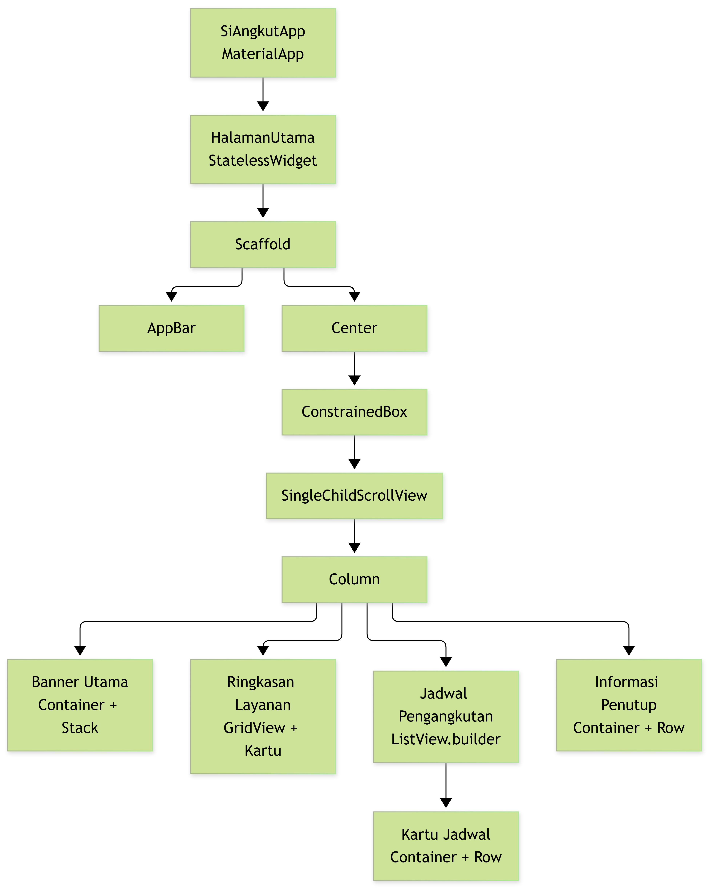

# Tugas 3 — Halaman Aplikasi Sederhana

## Identitas Mahasiswa

| Keterangan | Informasi |
|:---|:---|
| Nama | Clara Desmiati |
| NIM | 230660221005 |
| Kelas | SI-VIIA |
| Mata Kuliah | Pemrograman Aplikasi Bergerak |
| Nama Aplikasi | SIAngkut |

---

## 1. Deskripsi Aplikasi

**SIAngkut** merupakan aplikasi pelayanan pengangkutan sampah yang dirancang untuk membantu masyarakat memperoleh informasi mengenai layanan kebersihan lingkungan. Pada halaman utama, aplikasi menampilkan informasi lokasi pelayanan, iuran bulanan, jadwal pengangkutan, serta status pengangkutan sampah. Aplikasi ini berfokus pada pelayanan masyarakat di wilayah Tanggulun, Desa Cimalaka.

## 2. Domain Sistem Informasi

Domain yang dipilih adalah **Sistem Informasi Pelayanan Masyarakat**, khususnya pada bidang pengelolaan layanan pengangkutan sampah. Pemilihan domain ini didasarkan pada kebutuhan masyarakat untuk memperoleh informasi jadwal dan status pengangkutan sampah secara lebih mudah.

## 3. Implementasi Widget Flutter

Halaman aplikasi dibuat menggunakan struktur dasar Flutter, yaitu `MaterialApp` dan `Scaffold`. Beberapa widget layout digunakan untuk menyusun informasi agar lebih teratur dan mudah dipahami.

Widget yang digunakan meliputi:

| Widget | Fungsi |
|:---|:---|
| `MaterialApp` | Menjadi struktur utama aplikasi. |
| `Scaffold` | Menyediakan kerangka halaman aplikasi. |
| `Column` | Menyusun komponen secara vertikal. |
| `Row` | Menyusun komponen secara horizontal. |
| `ListView` | Menampilkan daftar informasi yang dapat digulir. |

## 4. Dokumentasi Tampilan

### Screenshot Halaman Aplikasi

Berikut merupakan hasil tampilan halaman aplikasi SIAngkut yang dijalankan menggunakan Flutter.

### Widget Tree

Berikut merupakan diagram struktur widget yang digunakan dalam halaman aplikasi.

## 5. Refleksi

Widget yang paling sulit saya rangkai adalah `ListView` karena perlu menyesuaikan susunannya dengan widget lain di dalam halaman. Saya harus memperhatikan penggunaan ruang agar daftar informasi dapat ditampilkan dengan baik. Setelah melakukan penyesuaian, halaman aplikasi dapat berjalan sesuai dengan kebutuhan.

