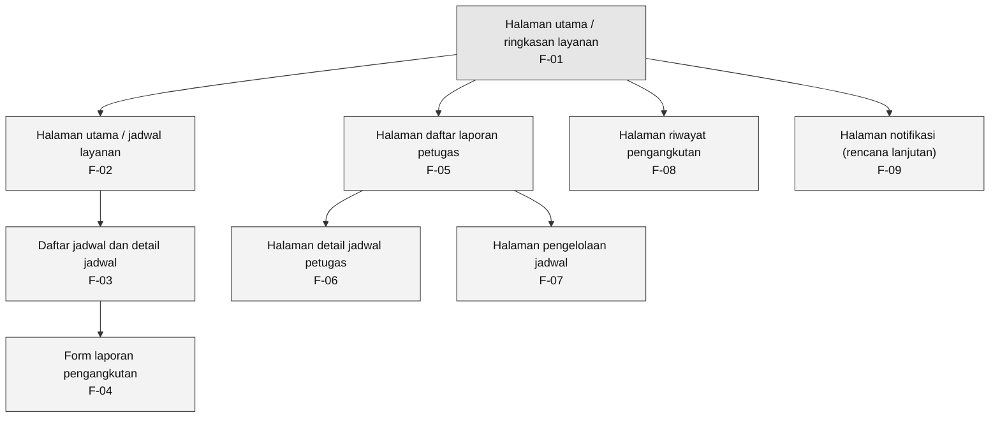

# Tugas 5 — Information Architecture SiAngkut

**Nama:** Clara Desmiati  
**NIM:** 230660221005 
**Mata Kuliah:** Pemrograman Aplikasi Bergerak

## 1. Inventaris Layar

Inventaris berikut diturunkan dari tabel pemetaan kebutuhan pada Tugas 4. Nama layar dipertahankan agar hubungan antara kebutuhan, rancangan, dan implementasi tetap konsisten.

| No. | Nama layar | ID kebutuhan yang dipenuhi | Keterangan |
|:--:|:--|:--|:--|
| 1 | Halaman utama / ringkasan layanan | F-01 | Menampilkan informasi iuran bulanan. |
| 2 | Halaman utama / jadwal layanan | F-02 | Menampilkan jadwal pengangkutan untuk wilayah layanan. |
| 3 | Daftar jadwal dan detail jadwal | F-03 | Menampilkan status pada jadwal yang dipilih. |
| 4 | Form laporan pengangkutan | F-04 | Memungkinkan warga mengisi keterangan laporan jadwal yang belum terlaksana. |
| 5 | Halaman daftar laporan petugas | F-05 | Menampilkan laporan yang dikirim warga. |
| 6 | Halaman detail jadwal petugas | F-06 | Memungkinkan petugas memperbarui status pengangkutan. |
| 7 | Halaman pengelolaan jadwal | F-07 | Memungkinkan petugas memperbarui informasi jadwal. |
| 8 | Halaman riwayat pengangkutan | F-08 | Menampilkan riwayat status periode sebelumnya. |
| 9 | Halaman notifikasi (rencana lanjutan) | F-09 | Menampilkan notifikasi perubahan jadwal jika fitur dikembangkan. |

## 2. Diagram Information Architecture

## 3. Alasan Pemilihan Layar Utama

Halaman utama dipilih sebagai layar utama karena langsung memenuhi kebutuhan Must have F-01 (informasi iuran), F-02 (jadwal pengangkutan), dan F-03 (status jadwal) yang paling sering dibutuhkan warga. Aksi menuju kebutuhan F-04 disediakan sebagai tombol utama pada halaman; pengisian laporan sendiri direncanakan pada layar pendukung **Form laporan pengangkutan** dan tidak menggunakan navigasi dalam prototipe Tugas 5.

## Batas Cakupan Prototipe

Berkas `halaman-utama.dart` mengimplementasikan layar utama SiAngkut saja, sesuai instruksi Tugas 5. Layar pendukung di IA dan wireframe adalah rancangan; halaman-halaman itu belum diklaim sudah terhubung atau berfungsi di aplikasi.
