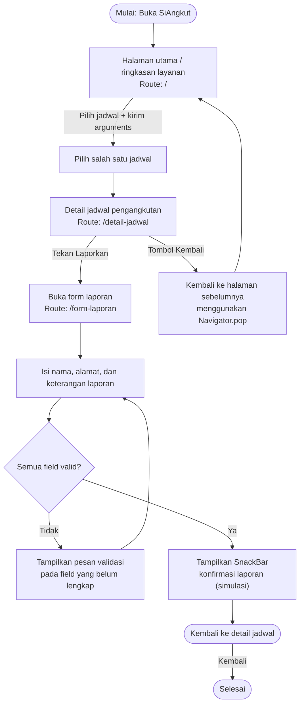

# Tugas 6 — Navigation Flow SiAngkut

**Nama:** Clara Desmiati  
**NIM:** 230660221005
**Mata Kuliah:** Pemrograman Aplikasi Bergerak

## 1. Tujuan Alur

Navigation flow ini menggambarkan proses warga SiAngkut melaporkan jadwal pengangkutan sampah yang belum terlaksana. Alur dimulai dari halaman utama, dilanjutkan ke detail jadwal, lalu ke form laporan. Form melakukan validasi sebelum menampilkan konfirmasi pengiriman laporan.

## 2. Daftar Route

| Nama Route | Layar | Kebutuhan yang Dipenuhi | Initial Route |
|:--|:--|:--|:--|
| `/` | Halaman utama / ringkasan layanan | F-01, F-02, F-03 | Ya |
| `/detail-jadwal` | Daftar jadwal dan detail jadwal | F-03 | Tidak |
| `/form-laporan` | Form laporan pengangkutan | F-04 | Tidak |

## 3. Diagram Navigation Flow

## 4. Pengiriman Data Antarlayar

Saat warga memilih jadwal di halaman utama, aplikasi mengirim objek jadwal melalui `arguments` pada `Navigator.pushNamed`. Layar detail memeriksa tipe data yang diterima dengan operator `is`; jika argumen tidak tersedia atau tipenya salah, aplikasi menampilkan pesan bahwa data jadwal tidak tersedia, bukan langsung melakukan konversi yang dapat menyebabkan error.

Saat warga membuka form laporan, data jadwal yang dipilih diteruskan ke form agar laporan berkaitan dengan jadwal yang benar. Setelah semua field valid, aplikasi menampilkan `SnackBar` sebagai konfirmasi simulasi dan kembali ke layar sebelumnya menggunakan `Navigator.pop`.

## 5. Alasan Pemilihan Initial Route

Route `/` dipilih sebagai `initialRoute` karena halaman utama langsung memenuhi kebutuhan Must have F-01 (informasi iuran), F-02 (jadwal pengangkutan), dan F-03 (status jadwal). Dari halaman ini, warga dapat memilih jadwal dan melanjutkan ke form laporan untuk memenuhi kebutuhan Must have F-04.

## 6. Catatan Implementasi

Nama route `/`, `/detail-jadwal`, dan `/form-laporan` harus sama persis dalam diagram, peta `routes` pada `MaterialApp`, serta semua pemanggilan `Navigator.pushNamed`. Form laporan pada Tugas 6 merupakan simulasi: validasi dan feedback berjalan, tetapi laporan belum disimpan secara permanen karena penyimpanan data menjadi materi Pertemuan 7.