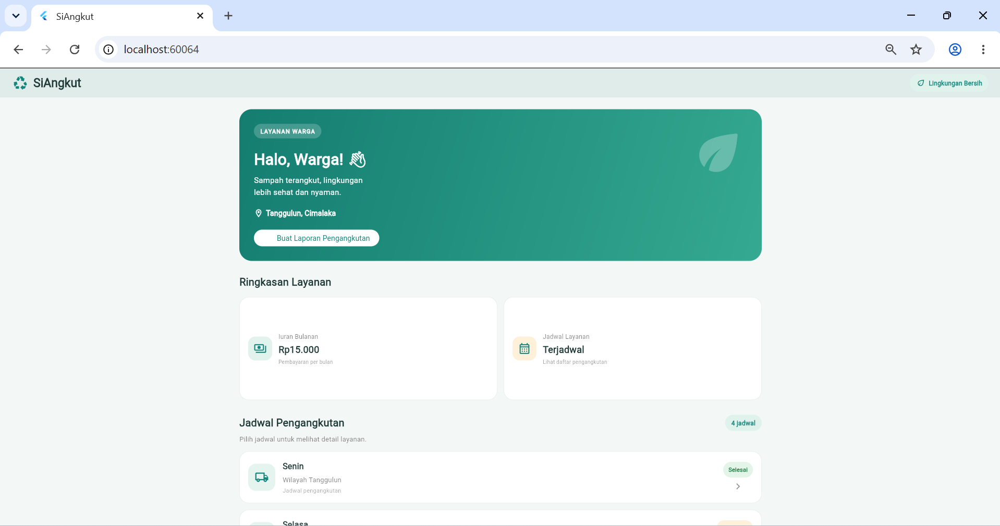
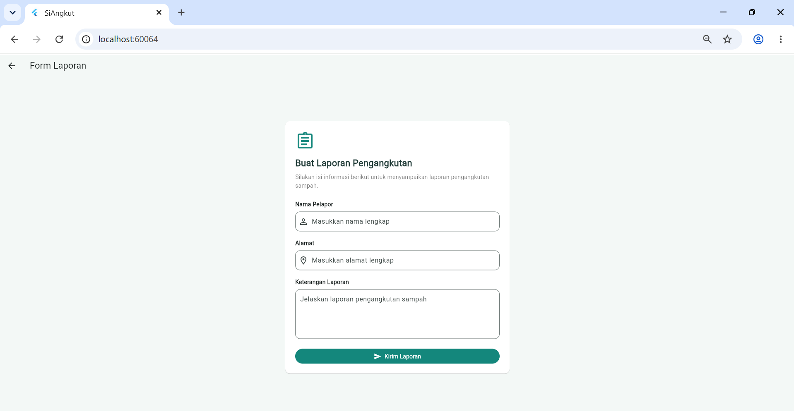
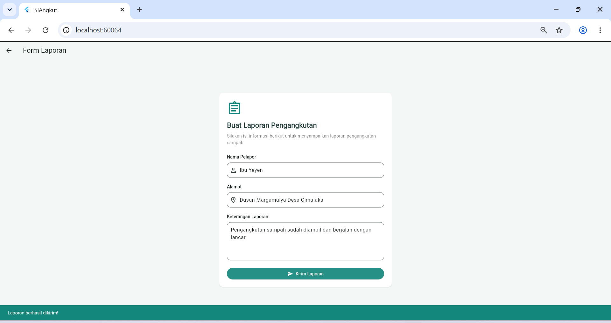
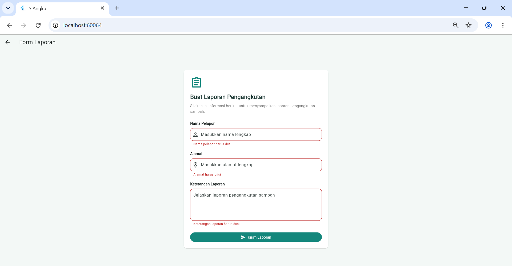
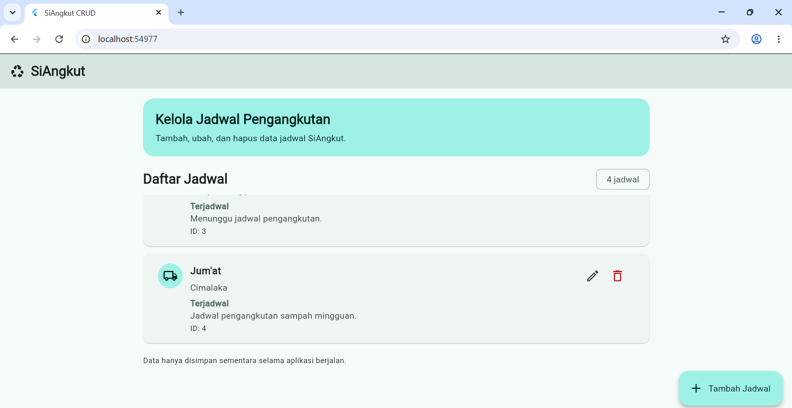
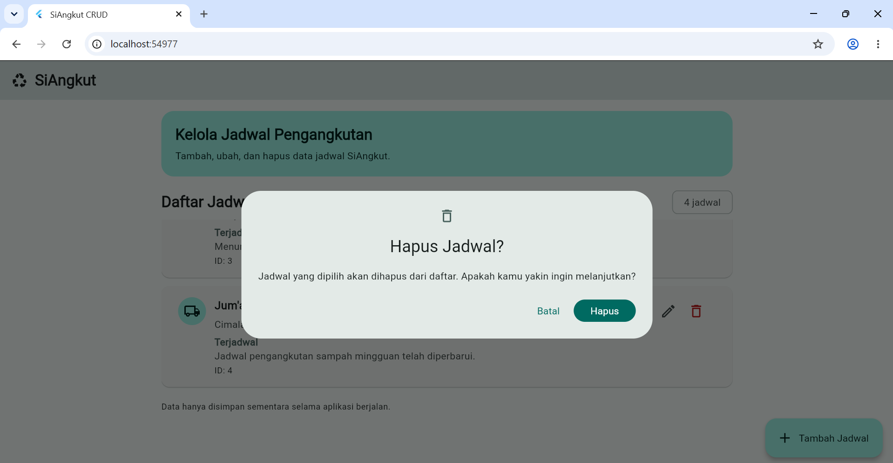

# LAPORAN PROGRESS PROJECT UTS
## Aplikasi SIAngkut

### 1. Identitas Mahasiswa

- Nama: Clara Desmiati
- NIM: 230660221005
- Kelas: SI-VIIA
- Mata Kuliah: Pemrograman Aplikasi Bergerak
- Nama Aplikasi: SIAngkut

### 2. Ringkasan Project

SIAngkut merupakan aplikasi bergerak yang dirancang untuk membantu masyarakat memperoleh informasi mengenai jadwal pengangkutan sampah. Aplikasi ini memiliki fitur daftar jadwal, detail pengangkutan, serta form laporan yang dapat digunakan oleh masyarakat untuk menyampaikan laporan terkait layanan pengangkutan sampah.

Pengembangan aplikasi dilakukan secara bertahap, mulai dari identifikasi kebutuhan, pembuatan modul, perancangan UI/UX, navigasi, hingga pengelolaan data lokal.

### 3. Progress Pengembangan

**Pertemuan 1 – Identifikasi Kebutuhan**

Mengidentifikasi permasalahan dan kebutuhan pengguna dalam layanan pengangkutan sampah. Hasil identifikasi digunakan sebagai dasar pengembangan aplikasi SIAngkut.

**Pertemuan 2 – Modul Hitung Nilai**

Mengerjakan modul menggunakan bahasa Dart dengan struktur data List dan Map.

**Pertemuan 3 – Flutter UI**

Membuat tampilan utama aplikasi SIAngkut yang menampilkan informasi layanan dan daftar jadwal pengangkutan sampah.

**Pertemuan 4 – User Flow**

Menyusun alur penggunaan aplikasi agar pengguna dapat memahami tahapan dalam mengakses fitur yang tersedia.

**Pertemuan 5 – Prototype UI/UX**

Membuat rancangan arsitektur informasi dan wireframe sebagai dasar perancangan tampilan aplikasi.

**Pertemuan 6 – Navigasi dan Interaksi**

Mengimplementasikan navigasi antarhalaman, form laporan, validasi input, serta notifikasi sebagai feedback kepada pengguna.

**Pertemuan 7 – CRUD Data Lokal**

Mengerjakan operasi tambah, tampil, ubah, dan hapus data menggunakan pengelolaan state lokal pada Flutter.

### 4. Kesesuaian Kebutuhan dengan Implementasi

| Kebutuhan | Implementasi |
|---|---|
| Melihat jadwal pengangkutan | Menampilkan daftar jadwal Senin sampai Kamis |
| Melihat detail jadwal | Pengguna dapat memilih jadwal untuk membuka halaman detail |
| Membuat laporan | Tersedia form Nama Pelapor, Alamat, dan Keterangan |
| Validasi input | Aplikasi menampilkan pesan ketika kolom wajib belum diisi |
| Feedback pengguna | Aplikasi menampilkan notifikasi setelah laporan dikirim |
| Mengelola data | Tersedia latihan fitur CRUD menggunakan data lokal pada Tugas 7 |

### 5. Bukti Implementasi Aplikasi

**1. Tampilan Daftar Jadwal**

Halaman utama menampilkan informasi jadwal pengangkutan sampah berdasarkan hari dan wilayah.

**2. Tampilan Form Laporan**

Form digunakan untuk memasukkan nama pelapor, alamat, dan keterangan laporan.

**3. Tampilan Validasi Form**

Aplikasi memberikan pesan kesalahan apabila pengguna menekan tombol kirim tanpa mengisi kolom yang wajib diisi.

**4. Tampilan Notifikasi Berhasil**

Setelah seluruh kolom diisi, aplikasi menampilkan notifikasi bahwa laporan berhasil dikirim.

**5. Bukti Pengelolaan Data Lokal**

Pada Tugas 7, dilakukan latihan pengelolaan data lokal menggunakan fitur CRUD. Berikut merupakan bukti tampilan daftar data dan konfirmasi penghapusan data.

### 6. Kendala dan Solusi

**Kendala 1: Pengaturan dan Struktur Project Flutter**

Pada proses pengembangan, sempat terjadi kesulitan dalam menjalankan project karena lokasi folder dan file konfigurasi Flutter tidak sesuai dengan direktori terminal.

**Solusi:** Memeriksa kembali lokasi project dan menjalankan perintah Flutter dari folder yang memiliki file `pubspec.yaml`.

**Kendala 2: Fitur Belum Memiliki Interaksi**

Pada awalnya tampilan utama aplikasi hanya menampilkan informasi dan belum memiliki fungsi klik maupun navigasi.

**Solusi:** Menambahkan fungsi interaksi menggunakan `InkWell`, `Navigator`, `TextFormField`, validasi form, dan notifikasi `SnackBar` sehingga pengguna dapat berinteraksi dengan aplikasi.

### 7. Rencana Pengembangan Selanjutnya (REST API)

Aplikasi SIAngkut direncanakan untuk dikembangkan menggunakan REST API. Pengembangan ini bertujuan agar data jadwal dan laporan dapat dikelola melalui server sehingga tidak hanya dikelola sementara di dalam aplikasi.

Beberapa rencana pengembangan meliputi:

- Membuat backend untuk pengelolaan data.
- Menghubungkan aplikasi Flutter dengan REST API.
- Menggunakan database untuk menyimpan data secara permanen.
- Menambahkan proses pengambilan dan pengiriman data melalui API.

### 8. Refleksi

Melalui pengembangan aplikasi SIAngkut, saya memperoleh pengalaman dalam membuat aplikasi menggunakan Flutter dan bahasa Dart. Saya juga mempelajari proses perancangan kebutuhan, pembuatan tampilan, navigasi, validasi form, serta pengelolaan data lokal. Selama pengerjaan terdapat beberapa kendala, tetapi dapat diselesaikan dengan memeriksa kembali kode dan struktur project. Saya menyadari bahwa aplikasi masih perlu dikembangkan, terutama pada bagian penyimpanan data agar dapat terhubung dengan database.

### 9. Pernyataan Penggunaan AI

AI digunakan sebagai alat bantu dalam memahami materi, menemukan kesalahan kode, dan membantu proses pengembangan aplikasi serta penyusunan dokumentasi. Implementasi dan pengujian aplikasi dilakukan kembali oleh mahasiswa untuk memastikan fitur berjalan sesuai kebutuhan. Tes konsep UTS dikerjakan secara mandiri sesuai ketentuan dosen.